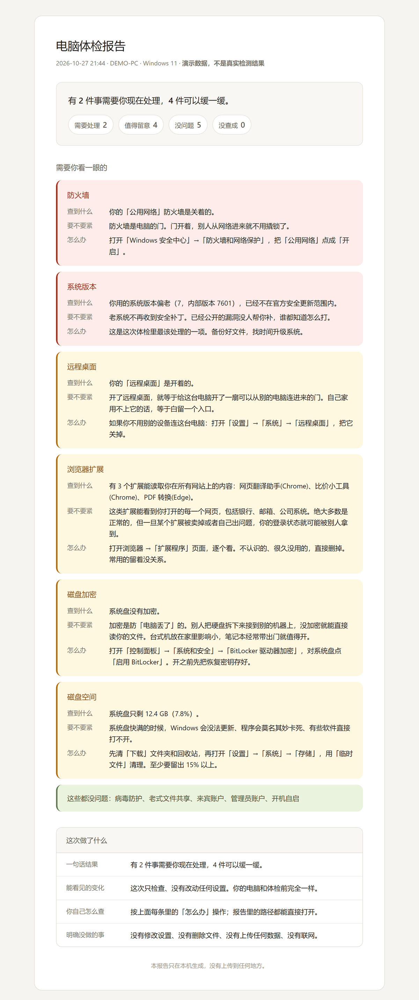

# 老百姓电脑体检

> 给不懂技术的人做的电脑体检。跑一遍，出一张红黄绿卡片，告诉你哪几件事该处理、怎么处理。

大部分人不是不想管电脑安全，是**看不懂那些报告**。

"检测到 3 个高危 CVE，建议升级至 22631.4317"——看到这句，普通人的反应是关掉窗口，然后继续用。

这个 skill 换个说法：

> 你的「公用网络」防火墙是关着的。防火墙是电脑的门，门开着，别人从网络进来就不用撬锁了。
> 打开「Windows 安全中心」→「防火墙和网络保护」，把「公用网络」点成「开启」。

**同样一件事，一个让你关窗口，一个让你动手。**

---

## 它能查什么

| 类别 | 查什么 |
|---|---|
| 上网安全 | 防火墙有没有关、病毒防护在不在跑、远程桌面开没开、老式文件共享开没开 |
| 账号安全 | 来宾账户有没有开、管理员账户是不是太多、硬盘有没有加密 |
| 系统健康 | 系统版本还受不受支持、开机自启是不是太多、磁盘是不是快满了 |
| 浏览器 | 有多少扩展能读取你在**所有网站**上的内容 |

共 11 项。每一项都只回答三个问题：**查到什么、要不要紧、怎么办。**

---

## 长什么样

<p align="center">
  
</p>

跑 `--html` 生成的就是这个，可以直接打印，也可以存成 PDF 发给家里人。


最后还有一张**四项验收卡**，照 `laobaixing-agent-reply` 的规矩：

- 一句话结果
- 你能看见的变化
- 你自己怎么检查
- 明确没做的事

---

## 怎么用

```sh
npx skills add https://github.com/jingdq11-web/laobaixing-computer-check
```

装完直接跟 agent 说：

> 帮我体检一下电脑
>
> 我电脑是不是中毒了
>
> 为什么开机越来越慢
>
> 这个弹窗要不要点

它就会跑检测、翻成人话、交卡片。

### 手动跑

不想装 skill，也可以直接用脚本：

```sh
python scripts/check_windows.py            # JSON，给 agent 读
python scripts/check_windows.py --human    # 人话版，调试用
python scripts/check_windows.py --html --out 报告.html   # 可打印报告
python scripts/check_windows.py --demo --html --out demo.html   # 演示数据
```

只要 Python 3.9+，**不用装任何包**。

---

## 三条设计原则

### 1. 只读

不改任何设置、不删任何文件、不装任何软件、不启动任何服务。

体检完，你的电脑和体检前一模一样。所有"怎么办"都得你自己点——**改设置这件事，必须你自己做决定。**

### 2. 不联网

所有检测都在本机完成，报告只写在本地。

它**不会**告诉你"你的密码有没有在别处泄露"——那需要联网比对，这个工具不做。要说清楚。

### 3. 说人话

给用户的回复里不出现：CVE 编号、注册表路径、端口号、协议名、命令行、字段名。

只出现：点哪里、点了会看到什么、这件事对你意味着什么。

---

## 和 Cloudflare 那个 skill 的区别

`cloudflare/security-audit-skill` 是这个月 GitHub 涨得最快的 skill（一周 1.6 万 star）。它很厉害，但它问的是：

> 这个代码库有什么漏洞？

它的门槛写在 README 里：需要 coding agent、需要并行子 agent、需要 OS 级沙箱。

**普通人连"代码库"是什么都不知道。**

这个 skill 问的是另一个问题：

> 我这台电脑安不安全？

同一个热点，相反的用户群。它输出 `findings.json`，这个输出一张能贴在冰箱上的卡。

---

## 已知边界

- **只做 Windows。** macOS / Linux 上会明说"这个工具现在只管 Windows"。
- **只体检，不治病。** 不修漏洞、不优化性能、不清理垃圾。
- **不查密码泄露。** 那需要联网，本工具不做。
- **磁盘加密那条通常要管理员权限。** 读不到就标"没查成"，不会假装查到了。

---

## 目录

```
laobaixing-computer-check/
├── SKILL.md                    # 给 agent 的说明书
├── README.md
├── scripts/
│   └── check_windows.py        # 只读检测 + 报告生成
├── references/
│   └── follow-up-answers.md    # 用户追问时怎么答
└── demo-report.html            # 演示报告（演示数据）
```

---

## 许可

MIT

---

同系列：[laobaixing-agent-reply](https://github.com/jingdq11-web/laobaixing-agent-reply-skill) — 干完活怎么跟不懂技术的人交代。
